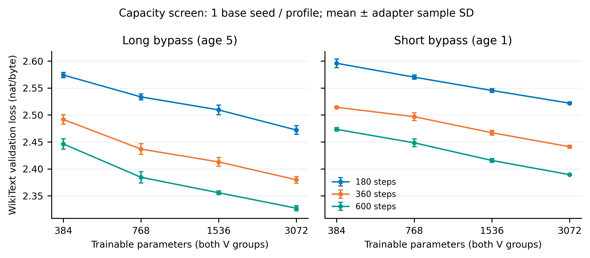
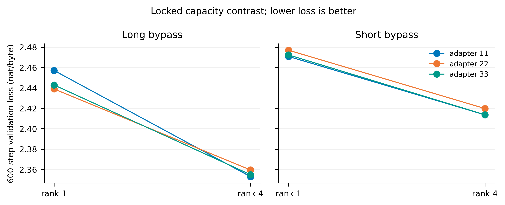

# 跨域容量筛查：这次观察到清楚的容量响应

运行`crossdomain_capacity_20261122_01`完成24条600步轨迹、72条定步验证记录。预先固定的容量门通过：rank4相对rank1，长旁路平均降低loss **0.09045**、短旁路 **0.05769 nat/byte**；两种宽度各3个adapter seed全部同向。这个设置能分辨容量差异，尚不证明任何CarryRank分配方法有效。

## 600步实测

每种宽度只有一个独立基础seed2026。表中均值±样本标准差来自adapter seeds11/22/33，主指标为官方WikiText-2 raw validation的固定65536预测字节，越低越好。仅末层V，C/R各64列并采用相同rank。

| 每组rank | 总可训练参数 | 长旁路loss | 短旁路loss |
|---:|---:|---:|---:|
| 1 | 384 | 2.44633 ± 0.00954 | 2.47340 ± 0.00319 |
| 2 | 768 | 2.38455 ± 0.01049 | 2.44841 ± 0.00719 |
| 4 | 1536 | 2.35588 ± 0.00337 | 2.41570 ± 0.00354 |
| 8 | 3072 | 2.32720 ± 0.00474 | 2.38940 ± 0.00132 |

冻结基座的源验证loss为长1.59077、短1.58731，目标验证为长3.13198、短3.22882。这里的跨域适配增益比同一Shakespeare后段明显，但不同数据、模型和验证样本不能直接作方法优劣比较。

600步的平均曲线在rank1/2/4/8上都下降。协议主对比预先选rank1与rank4，不是从曲线中挑最好的一点：

| 宽度 | seed11的loss下降 | seed22 | seed33 | 均值±配对样本SD | 容量门 |
|---|---:|---:|---:|---:|---|
| 长旁路 | 0.10408 | 0.07938 | 0.08789 | 0.09045 ± 0.01255 | 通过 |
| 短旁路 | 0.05722 | 0.05718 | 0.05869 | 0.05769 ± 0.00086 | 通过 |

## 为什么这轮有区分力

源训练仍来自固定Shakespeare前60%，目标改为[WikiText-2 raw](https://huggingface.co/datasets/Salesforce/wikitext/tree/b08601e04326c79dfdd32d625aee71d232d685c3/wikitext-2-raw-v1)。使用官方train/validation，不读test。模型改为8层等参数长短旁路，各935424参数，末层C/R均64列，单组rank成本均192，旁路年龄5/1。两种模型重新源预训练1200步。

容量扫描只改变两个V组的rank，保证所有rank下两组都可达。采用固定`1/sqrt(rank)`缩放、lr0.001、600步、同adapter seed配对批次。输入/输出白化和谱分配没有参与本轮训练，因此不能把容量响应归功于双侧代理。

这支持一个更有限而具体的判断：在这个跨域数据、固定适配范围和优化设置中，增加rank能带来稳定的有限步验证收益。它比首两轮的平坦曲线更适合接下来研究分配；不能严格区分表示容量与有限步优化效率，也不能说此前差异小只由容量饱和造成，因为本轮同时改变了任务、宽度、深度和训练设置。

## 验证与边界

- 24个末步adapter独立重载，验证loss最大误差0；所有实际参数与预算一致。
- 零初始化误差0，基座全程冻结，最大FP32合并误差5.72205e-6；全部宽度/rank的配对批次trace一致。
- 原方案和前三个既有结果包共559个文件SHA保持不变。测试集未读取，未据验证集挑步数。
- 当前只测一个基础seed/宽度，不能用三个adapter seed替代独立基础重复。长短旁路还混有层位置/信息历史，不是纯年龄因果实验。
- 原有0.01方法优势门不改。本轮通过的是新的**设置容量门**，不是C/R标签门或方法优势门。

协议在训练前锁定于[跨域容量协议](../plan/crossdomain-capacity-protocol.md)。全部数据、日志与重载证据见[结果包](../results/crossdomain_capacity_20261122_01/README.md)，主表见[main.csv](../results/crossdomain_capacity_20261122_01/main.csv)，独立审计见[checkpoint_audit.json](../results/crossdomain_capacity_20261122_01/checkpoint_audit.json)。可用`python scripts/verify_capacity.py results/crossdomain_capacity_20261122_01`无torch重算统计与门判定。

容量门通过后才运行下一阶段：3个基础seed、5个随机分组、预算384下的真实双侧分配与VBalanced对比，协议见[标签筛查协议](../plan/crossdomain-label-protocol.md)。其结果另行报告，不与本轮缩放常数不同的绝对loss混成同一张方法排名表。
