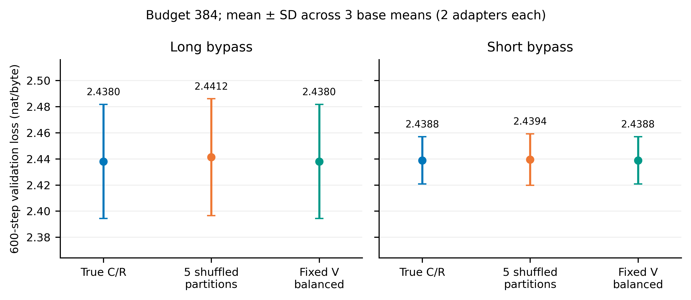
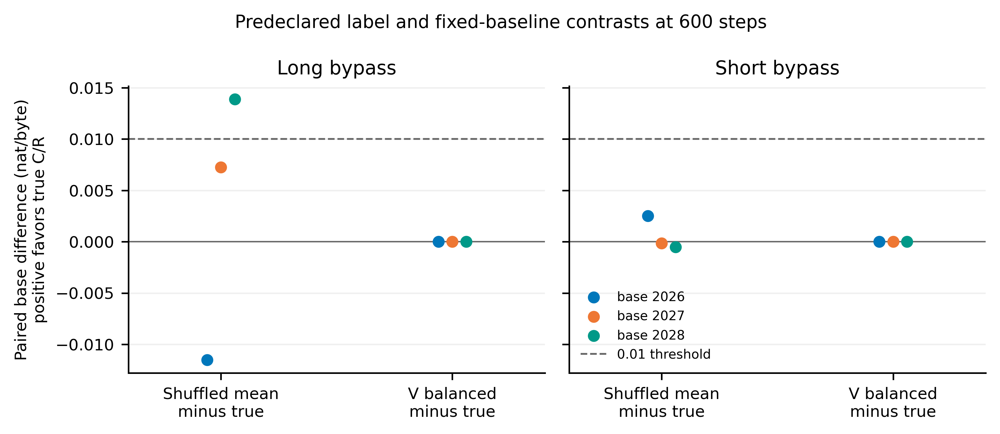

# 跨域、长短旁路与五个随机分组：完整标签筛查

正式运行`crossdomain_labels_20261122_01`完成84条600步轨迹、168条180/600步验证记录。每种宽度3个独立基础seed、每基础2个adapter seed，预算均384。

预定长旁路标签门：**未通过**；相对固定VBalanced的分配优势门：**未通过**。此前容量轮已测到稳定的rank响应；这两道门仍独立判断，不能拿容量响应代替方法收益。

## 600步验证结果

单位nat/byte，越低越好。先在每个基础内平均2个adapter seed，再跨3个基础算均值和样本标准差。随机分组一栏先在每基础内平均5个分组；不是把30个adapter×分组组合当独立基础样本。

| 条件 | 双侧真实C/R | 五随机分组均值 | 固定VBalanced |
|---|---:|---:|---:|
| 长旁路，年龄5 | 2.43799 ± 0.04368 | 2.44120 ± 0.04472 | 2.43799 ± 0.04368 |
| 短旁路，年龄1 | 2.43882 ± 0.01807 | 2.43943 ± 0.01965 | 2.43882 ± 0.01807 |

## 基础层面的配对差

正数表示真实分组更好。主对比为长旁路600步，要求3个基础全部改善且平均≥0.01，阈值没有因结果改变。

| 条件 | 基础seed | 随机分组均值−真实 | VBalanced−真实 |
|---|---:|---:|---:|
| long | 2026 | -0.011509 | +0.000000 |
| long | 2027 | +0.007249 | +0.000000 |
| long | 2028 | +0.013886 | +0.000000 |
| short | 2026 | +0.002507 | +0.000000 |
| short | 2027 | -0.000154 | +0.000000 |
| short | 2028 | -0.000515 | +0.000000 |

long的真实分组相对随机分组平均改善为+0.003208，基础配对差样本SD为0.013171。

short的真实分组相对随机分组平均改善为+0.000613，基础配对差样本SD为0.001651。

## 这里有一项需要明确的退化对照

在6个宽度/基础组合中，真实双侧代理有6个选择与VBalanced完全相同的列分组和rank。
全部为Q的C/R rank0、V的C/R各rank1。因此真实代理与固定基线是相同适配器结构、初始化和数据路径，loss完全一致是预期结果；不能把这一列解释成两个不同算法经过有区分力的比较后打平，也不能据此否定所有预算下的自适应分配。

五个随机控制仍有意义：尽管rank计数也相同，V的64/64列索引不同，对应不同的分组低秩更新族。真实C/R与随机分组的对比检验的是**分组本身**；本轮没有识别出额外的rank选择优势。

双侧白化在原校准轮恢复了标量Q/K重参数化不变性，但不会强制给Q rank。本轮Q依然取0，说明补上输出矩只是修复一个必要一致性缺陷，不保证局部评分会产生新的分配或更低验证loss。没有在本轮训练Q保底对照，不能进一步认定Q容量无用。

## 实际设置与验证

- 源域为固定Shakespeare前段，目标为固定revision的WikiText-2 raw官方train/validation；字节转换、下载和拼接SHA见data_manifest.json。未读取test。每次验证固定65536预测字节，不是完整validation或独立确认性测试。
- 两种8层宽度各935424参数，末层C/R各64列、每rank成本192。基础2026从容量轮核对后复制，2027/2028分别重新源预训练1200步。只适配末层Q/V，其他权重冻结。
- 双侧校准仅用目标train的12×16×128个预测字节，经验反传二阶矩与两侧相对阻尼0.01；精确DP预算384、rank cap8。不是精确Hessian或完整K-FAC。
- 本轮所有方法统一使用已测试的rs_ref3=sqrt(3/r)、lr0.001、600步；公共alpha与容量轮不同，不把跨轮绝对loss作为优化受控的算法对比。
- 独立重载84个末步adapter，验证loss最大误差0；最大FP32合并误差5.72205e-06；实际预算、冻结与配对批次trace全部通过。
- 原方案与既有结果包共559个文件保持SHA不变。24项正确性与协议测试通过；smoke单独保存，不计入84条正式轨迹。

## 允许的研究判断

新的跨域设置有可辨识的有限步容量响应，因此不能再仅用首两轮的平坦rank曲线解释这一轮的标签零结果。但本轮仍只覆盖一个目标语料、两种小模型宽度、末层Q/V和一个预算；分组作用、优化路径和局部代理近似仍可能影响结果。没有证据支持强行优先R或继续堆叠完整K-FAC/动态rank来争取预期方向。

长短模型匹配深度、参数量、宽度多重集与最终组大小，但层位置和信息历史仍不同，不能宣称识别了旁路年龄的纯因果效应。C/R标签门未通过只限制本轮的结构适配主张，不证明R表征没有作用或一般变宽Transformer都不存在结构差异。

下一轮若继续，应先用校准数据确认候选方法和固定基线在计划预算下确实产生不同的更新族/分配，再设计有区分力的训练对照；保留当前负/退化证据，不降低门槛、不把方法复杂度当作解决方案。

## 证据与复核

- [完整证据包](../results/crossdomain_labels_20261122_01/README.md)、[168行原始CSV](../results/crossdomain_labels_20261122_01/main.csv)、[基础配对差](../results/crossdomain_labels_20261122_01/base_comparisons.csv)
- [完整分配汇总](../results/crossdomain_labels_20261122_01/allocation_summary.csv)、[预定门判断](../results/crossdomain_labels_20261122_01/verdict.json)、[独立重载](../results/crossdomain_labels_20261122_01/checkpoint_audit.json)
- [运行前协议](../plan/crossdomain-label-protocol.md)、[先行容量结果](crossdomain_capacity_20261122.md)

无torch统计与SVD复核：`python scripts/verify_labels.py results/crossdomain_labels_20261122_01`。需要NumPy，不需要CUDA、模型权重或runs目录。
