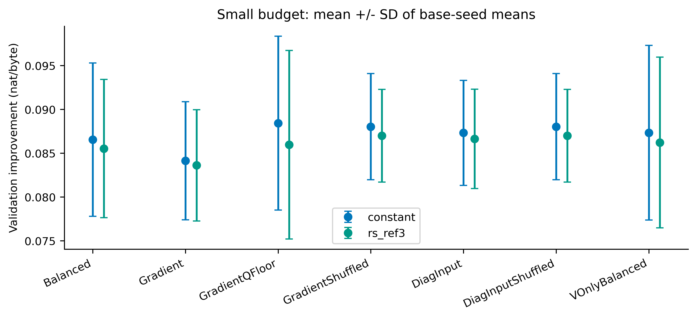
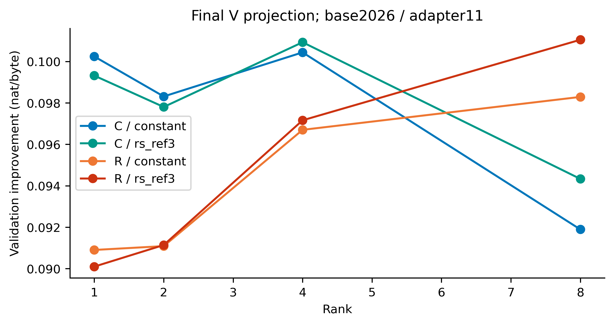
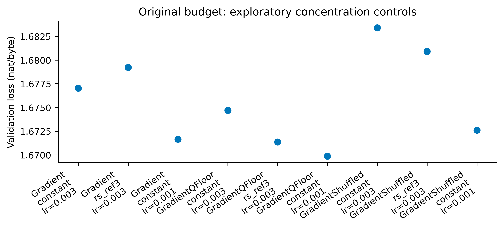

# 梯度谱为什么舍弃Q：第二轮诊断

本轮完成109条600步轨迹、218条固定步数验证记录。基础seed为2026/2027/2028，其中2026明确继承首轮检查点，其余两个重新预训练；每个基础用adapter seeds11/22。原始方案、正式pilot和第一轮证据包均未改。

主要判断：**首轮没有证明方法优越，也不足以否定方向。第二轮最明确暴露了代理的参数尺度依赖；容量饱和和优化动态也有实测迹象。** 目前仍未建立CarryRank相对普通LoRA的独立优势。

## 1. 一个保持函数不变、却改变分配的反例

对两个扩张层作`W_Q ← c W_Q`、`W_K ← W_K/c`。RoPE是线性的，因此注意力中的`QKᵀ`不变；对应rank的Q更新也可以乘c，保持rank和参数成本不变。本次在固定训练校准batch上验证：c=1、1/8、8的logits、loss差以及梯度变换误差均为0。

但原始平均梯度会满足`G_Q ← G_Q/c`，单位曲率谱评分随`1/c²`变化。实际3840参数分配为：

| Q倍数c | 原始谱分给Q的参数 | 对角输入归一化谱分给Q的参数 | 固定batch最大logit误差 |
|---|---:|---:|---:|
| 1 | 0 | 0 | 0 |
| 1/8 | 3008 | 3264 | 0 |
| 8 | 0 | 0 | 0 |

这不是背包或SVD算错，而是固定单位曲率的比较依赖坐标尺度。它说明**Q rank=0不能直接解释为Q没有适配价值**。输入二阶矩在这次输出侧重标定中不变，因此仅H_in归一化不能解决这个问题。

该反例不是Q改善泛化的证明，也没有训练重标定后的LoRA来比较学习曲线；固定A初始化和Adam过程本身也可能随参数化变化。它检验的是“将代理分数解释为rank容量的内在价值”这一主张。

证据：[参数化原始表](../results/parameterization_probe_20261122_01/parameterization.csv)、[来源与限制](../results/parameterization_probe_20261122_01/provenance.json)、[只读程序](../scripts/probe_parameterization.py)。

## 2. 输入尺度偏差得到部分支持

末层V的真实投影输入，C/R平均E[x²]分别为1.14658与0.58807。rank2的原始预测收益C/R比为5.788，而对角输入归一化后为2.853。尺度解释了部分差异，不能把“比值靠近1”本身当作正确答案。

小预算1024、训练600步时，对角输入版本相对原Gradient的基础seed配对验证loss改善为：

- constant：`+0.00457, 0.00000, +0.00500`，均值`+0.00319`。
- rs_ref3：`+0.00401, 0.00000, +0.00505`，均值`+0.00302`。

基础2027的两者rank配置相同，指标也相同。其余两个基础有小幅改善。该结果支持继续检查尺度问题，仍不能宣称输入归一化已解决代理问题或优于所有简单对照。

证据：[输入尺度probe](../results/calibration_probe_20261122_01/input_scale_probe.csv)、[第二轮谱](../results/diagnostic_20261122_02/base_2026/normalized_spectra.csv)。这里H_out=I，不是精确Hessian或完整K-FAC。

## 3. 同预算给Q留容量，有帮助但不是唯一解释

GradientQFloor在同一原始代理、同一参数预算下，要求两个扩张层Q各至少一个组rank非零，再精确优化剩余预算。它测的是Q/V容量交换，不能把所有改善都归因于Q本身。

1024参数、600步的结果如下。先聚合每个基础的两个adapter种子，再对三个基础汇总；std是三个基础均值之间的样本std。

| 方法 | constant Val loss ↓ | rs_ref3 Val loss ↓ |
|---|---:|---:|
| Balanced grouped | 1.67320 ± 0.00535 | 1.67421 ± 0.00692 |
| Gradient | 1.67561 ± 0.00561 | 1.67613 ± 0.00546 |
| GradientQFloor | **1.67132 ± 0.00230** | 1.67378 ± 0.00167 |
| GradientShuffled | 1.67172 ± 0.00645 | 1.67275 ± 0.00663 |
| DiagInput | 1.67242 ± 0.00554 | 1.67311 ± 0.00610 |
| VOnlyBalanced | 1.67241 ± 0.00167 | 1.67353 ± 0.00177 |

QFloor相对Gradient的配对改善：constant为`+0.00806,+0.00372,+0.00111`，三个基础同向；rs_ref3为`+0.00657,+0.00281,-0.00232`，出现反向。VOnlyBalanced也能取得接近的结果。因此，更稳妥的解释是原代理存在过度集中/尺度与训练路径问题，而不是已经识别出“Q必需”的普遍机制。

在1024预算下，GradientShuffled和DiagInputShuffled最终分配完全相同，因此省略后者的重复表行；完整原始表保留。新实验仍只有一个随机分组seed，不能建立C/R语义优势。

证据：[全部原始记录](../results/diagnostic_20261122_02/diagnostic.csv)、[按基础汇总](../results/diagnostic_20261122_02/by_base_summary.csv)、[基础内配对差](../results/diagnostic_20261122_02/paired_effects.csv)。

## 4. 容量与优化动态

固定基础2026/adapter11、constant缩放、末层V的C组，rank1只需320参数，600步验证loss为1.67059，改善0.10024；rank8为1.67894，改善反而只有0.09189。R组从rank1的1.67993降到rank8的1.67255。加长训练后，C早饱和、R继续上升的差异仍然存在。

这加强了“当前任务的主要适配收益可由很少参数获得”的证据，但单一组、基础和任务不足以证明全局容量永远不是瓶颈。

原3840参数、基础2026/adapter11的Gradient：

| 配置 | 180步Val loss | 600步Val loss |
|---|---:|---:|
| constant，lr0.003 | 1.67805 | 1.67703 |
| rs_ref3，lr0.003 | 1.67478 | 1.67922 |
| constant，lr0.001 | 1.67716 | 1.67166 |

首个配置180步精确复现首轮结果和批次trace。改变lr与scale能改变排名，而且早晚步方向不同；rs缩放没有一致改善。不能把“高rank步长更大导致失败”当作已经证实的唯一原因，也不能单独挑新lr最好的结果对比旧固定lr基线。

缩放使用`sqrt(3/r)`，在rank3与旧scale=1对齐，参考[rsLoRA原文](https://arxiv.org/abs/2312.03732)。它没有保证Adam下所有真实更新步长相同，更新范数已实际记录。

## 5. 时间变化与审计

对末步Gradient适配器只读重测同一训练校准集，Q/V首rank单位参数代理收益的总和比值，在三个基础下由`0.02783/0.01492/0.03139`变为`0.05454/0.04473/0.05100`（constant），增幅约1.6–3倍。Q的相对局部需求随训练变化，但仍低于V；不能说静态评分的所有失效都已由时间漂移解释。

该分析为事后只读诊断，不更新权重、不重分rank。证据：[末步梯度](../results/diagnostic_20261122_02/late_gradient_probe.csv)。

- 16项正确性测试通过；109条完整轨迹的8项运行审计全部通过，最大合并误差8.58e-06。
- 109个最终adapter独立重载，验证loss复现误差0。该核验不等于109次独立预训练重复。[检查点审计](../results/diagnostic_20261122_02/checkpoint_audit.json)。
- 原始391个导出文件带SHA-256。附加只读分析另有补充清单，原始run、原始源代码快照和第一轮结果不改。
- 补测首轮冻结基础的目标测试loss为1.82524514（同16384字节），存放于单独probe，未回写首轮`pretrain.json`。
- 中间步没有保存adapter tensor；连续更新范数和固定验证loss有日志，输出变化只对末步补测。不能由此重构180步的完整模型状态。

## 6. 允许的研究结论

这轮补充支持三个方向：代理评分的尺度依赖确实存在；简单输入归一化有部分改善；容量集中和优化路径都影响结果。它仍没有证明CarryRank优于普通LoRA，尤其不能把原任务上C-only较好解释成所有R维度都不重要。

R维度的重要性、R对应参数的适配收益、R需要多少rank是不同概念。结构感知方法也不要求R总应获得更多参数。新方法在加入更复杂优化器前，应先检查评分对等价参数化的稳定性，再独立检验收益排序；完整K-FAC、动态rank和V2仍未实现。

本轮没有新增跨领域任务、宽度形状或随机分组种子；全部是基于首轮观察提出的验证诊断，没有新的独立确认性测试。预设0.01门槛保留在首轮记录中，不改成事后更容易通过的门槛；观测到的方法差距小于0.01也不证明所有可能方法在理论上都无法达到它。
