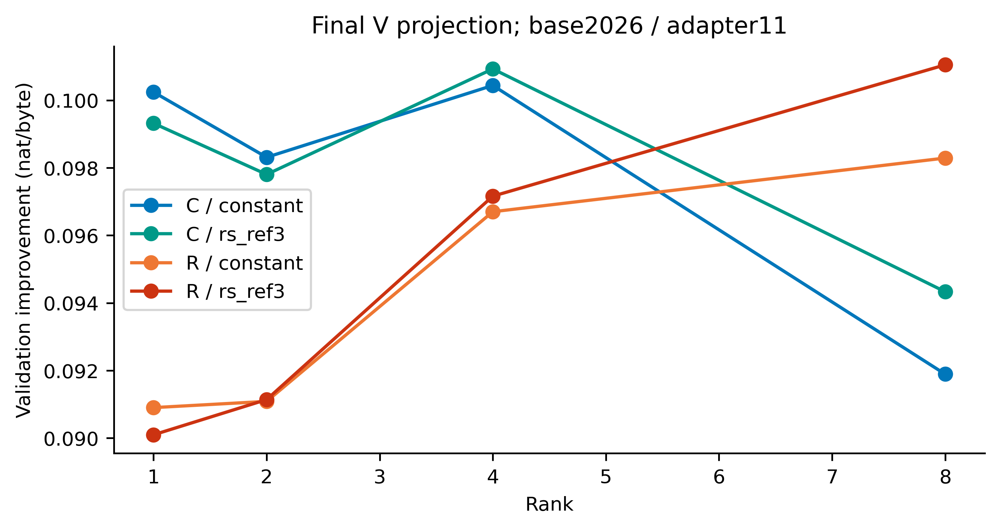
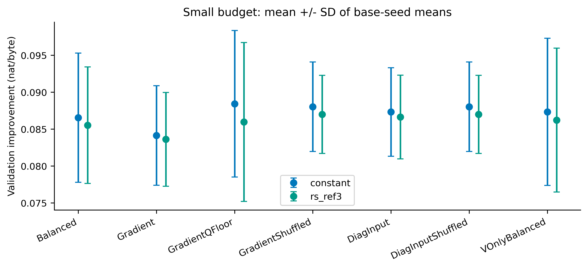

# 首轮复核后的第二轮诊断

**修正结论：首轮只说明该设置下未测出稳定收益，不能否定CarryRank方向，也不能据此排除低成本曲率归一化。第二轮确认了输入尺度和rank缩放的混杂，但尚未证实真实C/R历史比任意同形状分组更有价值。**

运行`diagnostic_20261122_02`完成109条600步轨迹、218条固定验证记录：3个独立预训练基础，每个基础2个adapter seed。原始方案、首轮run与首轮证据包不改。

## 数据与核验

- [完整CSV](../results/diagnostic_20261122_02/diagnostic.csv)、[每基础汇总](../results/diagnostic_20261122_02/by_base_summary.csv)、[配对差](../results/diagnostic_20261122_02/paired_effects.csv)、[自动报告](../results/diagnostic_20261122_02/report.md)。
- [协议](../plan/diagnostic-protocol.md)、[逐文件哈希](../results/diagnostic_20261122_02/artifact-manifest.json)、[运行审计](../results/diagnostic_20261122_02/diagnostic_verification.json)。
- [纯标准库独立核验](phase2_evidence_verification.json)、[109个检查点重载核验](phase2_checkpoint_audit.json)。
- [同函数Q/K重参数化探针](../results/parameterization_probe_20261122_01/parameterization.csv)及[来源与限制](../results/parameterization_probe_20261122_01/provenance.json)。该探针是事后只读分析，无额外训练。

没有torch也可运行：`python scripts/verify_phase2_evidence.py results/diagnostic_20261122_02`。已核对391个文件、CSV与原始完成日志、参数成本、Q保留约束，重算基础内均值和配对差，并独立求解18组代理优化问题。另从磁盘重载109个最终检查点，验证loss复现误差均为0。

进一步的[完整解读](diagnostic_20261122.md)包含只读末步梯度分析。每个基础还导出了不含模型权重的`calibration_arrays.npz`与键名JSON，可用NumPy打开；`python scripts/verify_diagnostic.py results/diagnostic_20261122_02 --spectra`可以重新计算所有校准谱，不需要torch、CUDA或原始run。用法见[证据包说明](../results/diagnostic_20261122_02/README.md)。

## 输入尺度偏差存在，白化只修正了一部分

末层V、rank2的校准结果：

| 基础seed | C/R输入E[x²]比 | 原预测C/R比 | 输入归一化后预测C/R比 |
|---|---:|---:|---:|
| 2026 | 1.950 | 5.788 | 2.853 |
| 2027 | 1.954 | 4.887 | 2.312 |
| 2028 | 1.976 | 4.841 | 2.412 |

每个基础的原值在`base_*/normalized_spectra.csv`，每维二阶矩在`base_*/input_second_moments.json`，均为可读文本。输入尺度确实影响评分，但C/R维度数量、输出曲率、坐标相关性和后续优化也可能影响效用；不能以“比例接近1”为正确性的标准。当前只有对角H_in，H_out=I，不是完整K-FAC或精确Hessian。

## 不同rank的初始更新尺度确实不同

基础2026、adapter11、末层V的C组，第一步合并delta的Frobenius范数：

| Rank | 固定scale=1 | 固定alpha=sqrt(3)的alpha/sqrt(rank) |
|---:|---:|---:|
| 1 | 0.010538 | 0.018253 |
| 2 | 0.014279 | 0.017490 |
| 4 | 0.018418 | 0.015950 |
| 8 | 0.026135 | 0.016003 |

rs缩放使这次测量更接近，不保证Adam下所有rank的等效步长或泛化一致；定义参考[rsLoRA原文](https://arxiv.org/abs/2312.03732)。

原3840预算、已知失败seed11的事后对照：Gradient的600步loss由lr0.003的1.67703，降到lr0.001的1.67166；只换rs缩放且保持lr0.003为1.67922。学习率确实影响排名，rs并未自动修复性能。不能据此给某个方法单独挑最好lr再宣称公平胜出。

## 容量曲线具有组别差异

基础2026、adapter11、600步，固定缩放下C组rank1/rank4的loss为1.67059/1.67040，rank8反而为1.67894；R组由rank1的1.67993降到rank8的1.67255。rs条件下R组rank8为1.66979。

这支持“C低rank已够用，R仍有rank收益”的局部现象，不能笼统推出所有组容量都不是瓶颈。扫描只有一个基础与适配种子，且不同rank参数成本不同，不属于等预算主比较。

## 小预算下输入归一化有改善，结构标签优势仍未识别

预算准确1024、固定600步。先在同一基础内平均两个adapter seed，再对三个基础求均值；基础间std与逐基础配对差见完整报告。

| 方法 | 固定scale | rs_ref3 |
|---|---:|---:|
| Balanced | 1.67320 | 1.67421 |
| Gradient | 1.67561 | 1.67613 |
| GradientQFloor | 1.67132 | 1.67378 |
| DiagInput | 1.67242 | 1.67311 |
| DiagInputShuffled | 1.67172 | 1.67275 |
| VOnlyBalanced | 1.67241 | 1.67353 |

- 固定scale时，DiagInput相对Gradient三个基础的改善为0.00457、0、0.00500，均值0.00319；rs条件均值0.00302。
- DiagInput相对随机分组的差值为-0.00152、+0.00157、-0.00218，均值-0.00071，没有稳定结构优势。
- 固定scale时，QFloor相对Gradient在三个基础都改善；VOnlyBalanced也在三个基础都改善。因此不能只凭QFloor收益断言“Q重要”，两种控制也改变了V容量与优化路径。
- GradientShuffled和DiagInputShuffled在本轮得到了相同rank选择、对应结果相同；完整表保留两行，不当作两份独立证据。
- 小预算无法让所有组非零rank，整数成本量化效应较强；Balanced不是标准固定rank LoRA。本轮未声称胜过已有LoRA方法。

## 跨Q/V评分还依赖参数化

只读探针将`W_Q'=c W_Q, W_K'=W_K/c`，保持attention点积与模型函数不变。c=1/8或8时，该批实测logits误差和梯度变换相对误差均为0。

3840预算下，仅把c由1改为1/8：

| 评分 | 原参数化分给Q | 等价参数化分给Q |
|---|---:|---:|
| 原始梯度 | 0 | 3008 |
| 只归一化输入 | 0 | 3264 |

同一基础函数得到不同的容量评分，说明原始梯度和输入单侧归一化仍对Q/V坐标尺度敏感。输入白化没有处理输出侧的参数化变化。这给进一步检查输出侧度量提供依据，不证明完整曲率必然改善泛化；固定初始化与有限步Adam也不保证重参数化不变。

## 判断与边界

应先检验代理评分的尺度和优化依赖，再用新任务确认C/R历史标签是否带来额外信息。不能把首轮结果作为方向被否定的证据，也不能把本轮输入归一化的局部改善当作方法成功。

本轮依据首轮现象设计，仍是三个小模型、单语料后段适配、固定校准与随机分组种子的验证诊断；不是独立确认性测试。保留原门槛、负结果及全部日志，当前未扩展完整K-FAC、动态rank或V2。
