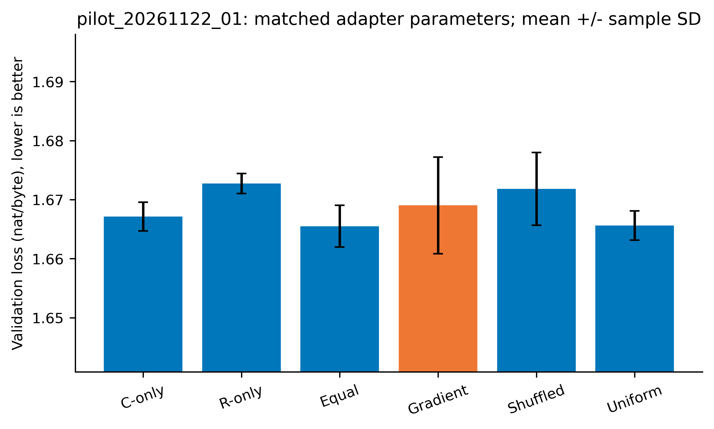
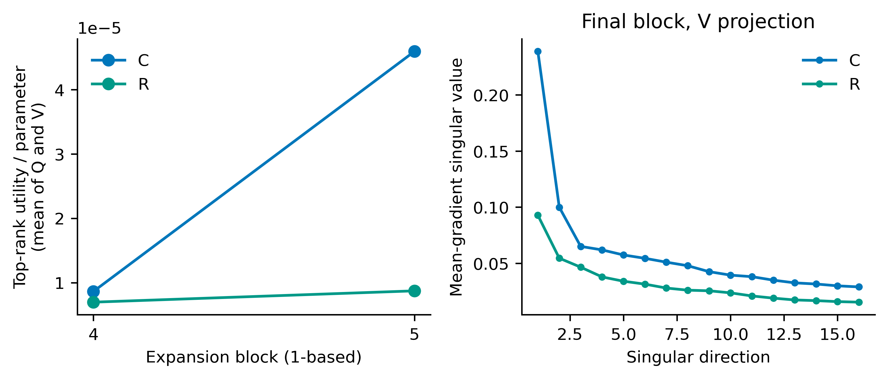
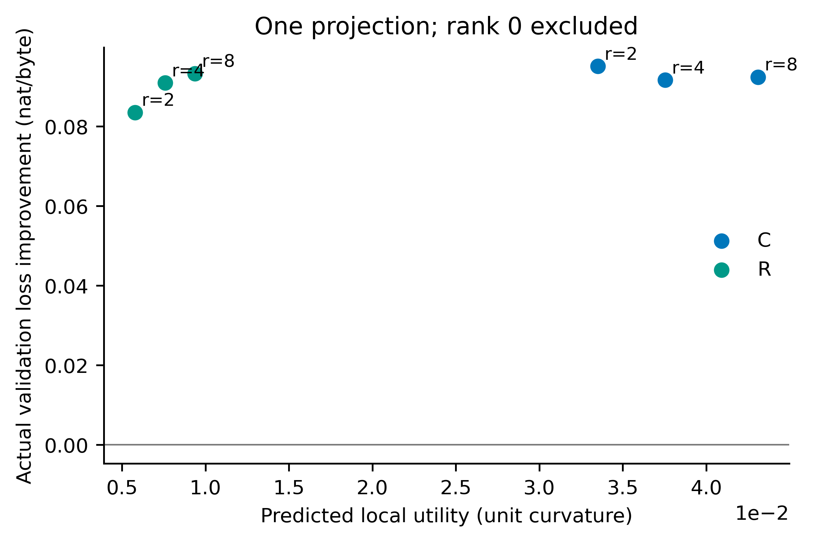

# CarryRank-LoRA：首轮最小验证

正式运行：`pilot_20261122_01`。完整[运行报告](../results/pilot_20261122_01/report.md)、[原始主表](../results/pilot_20261122_01/main.csv)、[最终判定](../results/pilot_20261122_01/verdict.json)、[检查点重载审计](../results/pilot_20261122_01/checkpoint_audit.json)、[证据包索引](../results/pilot_20261122_01/README.md)。

**工程链路通过，预设方法优势门未通过。** 目前没有证据支持直接投入K-FAC、动态rank或跨组混合；这不构成对大模型或其他任务的否定。

环境直接复用`E:\envs\LangChain_agent\python.exe`（Python3.11.14、torch2.14.1+cu126），没有修改其依赖。WSL只补了venv系统组件，原本的CUDA依赖安装因下载超时退出，未用来训练。用户授权后退出NVIDIA浮层和手机连接后台，保留编辑器、当前聊天和桌面。

## 实验与结果

自实现、从头预训练的1,439,296参数变宽decoder，宽度`[192,128,64,128,192]`，保留真实残差旁路；不是MIT模型原实现或官方权重复现。Tiny Shakespeare固定提交按连续字节位置划分源训练/源验证/目标训练/目标验证/目标测试，split无位置交叠。预训练1200步，适配每次180步；校准只读目标训练集。6方法×3适配种子，共用1个预训练基础。

源验证loss从5.55272降到1.57062；冻结基础的目标验证loss为1.77083。每个主对照3840可训练参数，LoRA缩放恒1，零增量初始化，逐字节训练batch顺序散列在配对种子内相同。

| 方法 | 目标验证loss，均值±样本std ↓ | 目标测试loss，均值±样本std ↓ |
|---|---:|---:|
| C-only | 1.66715 ± 0.00244 | 1.73694 ± 0.00460 |
| R-only | 1.67273 ± 0.00167 | 1.74762 ± 0.00141 |
| C+R Equal | 1.66550 ± 0.00353 | 1.74116 ± 0.00178 |
| Gradient CarryRank | 1.66903 ± 0.00818 | 1.75202 ± 0.00658 |
| Shuffled Adaptive | 1.67183 ± 0.00616 | 1.75036 ± 0.00842 |
| Uniform LoRA | 1.66563 ± 0.00247 | 1.73987 ± 0.00309 |

loss单位为nat/byte。3个种子是适配器种子，不能当作3个独立预训练重复；不作显著性或大模型优越性声明。

- C-only在三个种子的验证和测试loss上均低于R-only，本配置未支持“R应该优先”。
- Gradient在验证上比同形状随机分组平均好0.00281，但比Equal差0.00352、比Uniform差0.00339；优势门要求的三个种子一致胜出及至少0.01改善均未满足。
- 固定最终V投影的6个非零rank点，预测/实际验证改善Spearman=0.5429；C组内为-0.5，R组内为1.0。整体相关主要混合组别和rank影响，不能说已经可靠预测rank边际价值。
- 梯度分配把全部Q rank降为0，主要投入V；这属于代理目标的选择，尚不能解释为Q在实际适配中无价值。实际配置见`allocations.json`。

## 验证与运行注意事项

- 10项unittest通过；正式run的12项工程审计全通过。最大FP32合并输出绝对误差`9.5367431640625e-06`，阈值`1e-4`。
- 从磁盘独立重载18个adapter checkpoint，参数和冻结基础散列一致，验证loss复现误差为0。重新SVD核对全部校准效用，与保存值差为0。
- 预训练测得84.51s，校准0.63s；适配torch峰值allocated约100–102MiB，预训练峰值239.79MiB。显存不含驱动/桌面；墙钟/延迟受桌面、温度及一次短程smoke检查点审计并发影响，只是本机诊断，不是受控吞吐基准。
- 配置、环境freeze、数据与源码散列、基础checkpoint、适配器、所有attempt日志、CSV和PNG/SVG在该run下保留。`研究方案.md`未改，SHA256=`ef6fc54d197af6f3d3f9d612a40c843a90c9f8482362ef2008f270847d3e3cb2`。
- 小型可审查证据已经导出到`results/pilot_20261122_01/`，生成图在`figures/pilot_20261122_01/`，共106个文件经SHA-256核对；CSV汇总、原始完成日志和rank谱预测均已交叉验证。原始tensor仍在run目录，导出包不复制tensor，但列出其散列；迁移完整检查点时需一并备份。
- 如要进一步研究，先增大基础预训练种子、随机分组种子和任务/宽度覆盖，分析校准样本与组内rank预测的稳定性。本轮止于最小验证，不添加二阶复杂度。

复现命令见[README](../README.md)，完整协议见[实验协议](../plan/experiment-protocol.md)。

## 后续复核说明

首轮未通过预设初筛，不足以排除最便宜的输入归一化诊断。第二轮已按独立协议完成109条轨迹；确认了尺度/优化混杂，真实C/R历史的额外优势仍未证实。参见[第二轮复核](diagnostic_review_20261122.md)。首轮run、原始CSV、门槛和已导出证据包不改。
