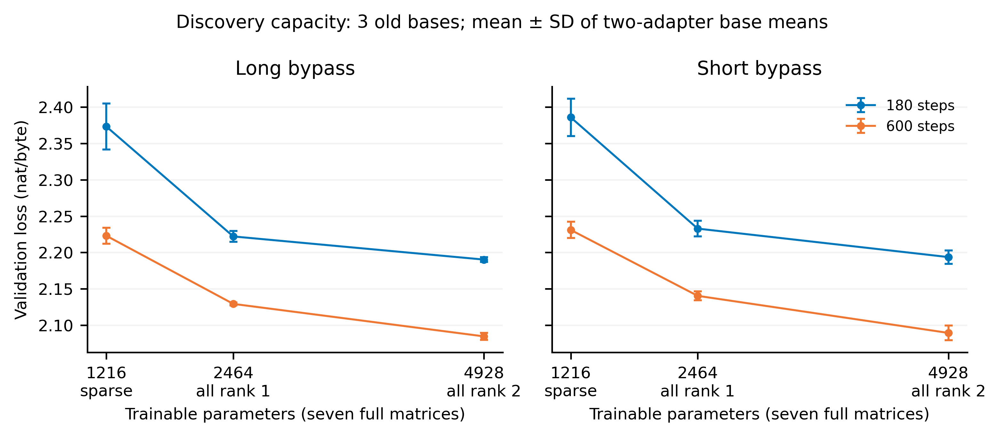

# 七类矩阵的容量复核：通过预定设置门

36条发现轨迹、72条180/600步记录，旧基础2026–2028、adapter11/22。只训练相同末层Q/K/V/O和up/gate/down的整矩阵LoRA，使用锁定的FullBudgetBalanced、lr0.001、alpha/sqrt(rank)、600步。它用于判定新适配范围是否容量吃紧，不混入10新基础的主试验置信区间。

| 参数预算 | long 600步loss | short 600步loss |
|---:|---:|---:|
| 1216 | 2.22303 ± 0.01095 | 2.23106 ± 0.01131 |
| 2464 | 2.12929 ± 0.00199 | 2.14036 ± 0.00631 |
| 4928 | 2.08461 ± 0.00478 | 2.08937 ± 0.00997 |

均值/样本SD跨3个基础均值，每基础先平均两个adapter。2464与4928分别为七矩阵全部rank1/rank2；1216是稀疏整数均衡，不称严格Uniform。

## 训练前固定的容量门

| 宽度 | 区间 | 三个基础配对改善 | 平均 | 通过 |
|---|---|---|---:|---|
| long | 1216→2464 | +0.08463/+0.10841/+0.08817 | 0.093738 | True |
| long | 2464→4928 | +0.04141/+0.04356/+0.04909 | 0.044683 | True |
| short | 1216→2464 | +0.09600/+0.09118/+0.08490 | 0.090695 | True |
| short | 2464→4928 | +0.04710/+0.05057/+0.05530 | 0.050994 | True |

两个区间、两宽度均满足三个基础的配对均值全正且平均改善≥0.01，因此允许启动正式主试验。七矩阵完整rank1加到rank2仍改善约0.045/0.051，不能再直接套用旧V-only的平坦曲线。容量响应在此固定优化过程下有区分力，但不证明C/R标签、代理分配或纯旁路年龄机制。

## 审计

36个末步adapter完整模型独立重载，验证loss误差0；初始化误差0、冻结基座与配对trace通过，缓存对完整路径误差0，FP32合并最大误差7.62939453125e-06。旧方案与1062个旧结果文件SHA未改。测试集未使用。并发运行时的耗时只作描述，不作为不同算法的隔离性能比较。

[运行前协议](../../plan/decisive-stage0-protocol-v1.md) · [证据包](../../results/decisive_capacity_20261122_01/README.md) · [原始CSV](../../results/decisive_capacity_20261122_01/main.csv) · [完整重载](../../results/decisive_capacity_20261122_01/checkpoint_audit.json)
