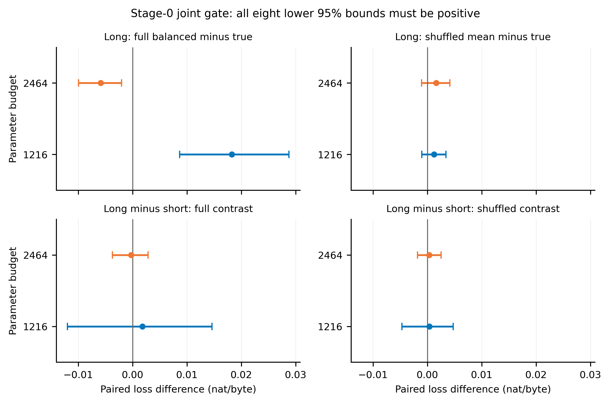
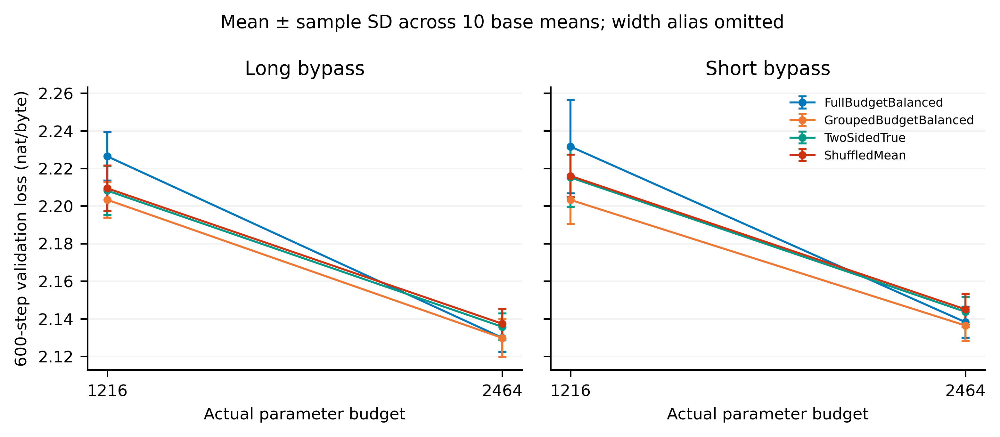

# 第0步决定性小实验：按锁定规则转入B路线

状态：正式运行完成，非smoke。20个新预训练模型（长、短各10个基础种子2029–2038），每基础2个adapter种子11/22、2个预算、5个随机分组。720个逻辑条件包含80个明确标记的宽度基线别名，实际完成640条独立优化轨迹、1440条180/600步验证记录。没有新增测试集结果。

**预先锁定的A路线联合门未通过，选择B。** 1216预算的真实双侧分配优于稀疏整矩阵均衡基线，但未稳定胜过同形状随机分组；2464预算下，末层七矩阵全rank1的标准LoRA更好。两预算的长减短交互区间都包含0。这里的B是本轮决策，不是所有变宽模型上C/R无效的证明。

## 实际执行的规格

- [训练前协议](../../plan/decisive-stage0-protocol-v1.md)和配置在结果前固定；旧轮门槛及原始方案保留。
- 用户确认采用整数预算均衡基线，以相同末层七类矩阵为主比较；全部扩张层只做离线补充。Q/K/V/up/gate按输入残差列切分，O/down按输出残差行切分。
- 严格整矩阵统一rank1需2464参数，严格所有分组统一rank1需4032；原六预算无法同时满足。离线仅用训练校准数据选出1216/2464。FullBudgetBalanced在1216是稀疏整数均衡，不能叫严格Uniform；在2464恰为七矩阵全rank1。GroupedBudgetBalanced同样不冒充严格全组统一rank。
- WidthRankProportional在本末层宽度一致的设置中与GroupedBudgetBalanced完全相同，结果显式复用，没有伪造重复训练。原VBalanced只用作离线几何参照，不是本轮训练对照。
- 模型各935424参数、8层，长/短末层旁路年龄5/1；总宽度多重集和末层候选矩阵相同。宽度历史及位置仍不同，因此交互不是纯旁路年龄因果效应。
- TinyShakespeare源预训练1200步；官方固定revision的WikiText-2 raw train适配600步。所有方法同lr=0.001、alpha=sqrt(3)、scale=alpha/sqrt(rank)、同批次顺序。目标验证为固定分散512块、65536预测字节，非完整验证切分；WikiText test未读取。
- 双侧对角量来自输入与反传信号的经验二阶矩，非精确Hessian/Fisher。容量门用旧2026–2028基础；主比较只用新2029–2038基础，不能把固定任务上的重复当成多任务泛化。

## 主指标：基础为单位的配对区间

差值定义为对照loss − TwoSidedTrue loss，正值有利于真实分组。先平均2个adapter、再平均5个随机分组，按10个基础共享重采样索引做200000次percentile bootstrap，95% CI。长减短在同基础seed内计算。以下12项完整报告；A要求两预算各4项预设主对比下界全部>0，不从结果中挑一个预算过关。区间是逐项区间，不是同时置信带。

|预算|对比|均值|95% CI|A门必需|
|---|---|---:|---|---|
|1216|长：整矩阵均衡−True|+0.018248|[+0.008654, +0.028772]|是|
|1216|长：随机均值−True|+0.001230|[-0.001019, +0.003420]|是|
|1216|短：整矩阵均衡−True|+0.016460|[+0.006210, +0.027237]|否|
|1216|短：随机均值−True|+0.000846|[-0.002720, +0.004521]|否|
|1216|长−短：整矩阵对比|+0.001788|[-0.011989, +0.014605]|是|
|1216|长−短：随机对比|+0.000384|[-0.004698, +0.004738]|是|
|2464|长：整矩阵均衡−True|-0.005852|[-0.009934, -0.002040]|是|
|2464|长：随机均值−True|+0.001624|[-0.001047, +0.004132]|是|
|2464|短：整矩阵均衡−True|-0.005563|[-0.008906, -0.002013]|否|
|2464|短：随机均值−True|+0.001284|[-0.001266, +0.003725]|否|
|2464|长−短：整矩阵对比|-0.000289|[-0.003730, +0.002860]|是|
|2464|长−短：随机对比|+0.000341|[-0.001820, +0.002527]|是|

## 600步实测验证loss

均值 ± 样本SD跨10个基础均值，不将20个adapter当成20个独立基础。5个随机分组的逐项结果完整保留在summary.csv，这里展示其均值。

|宽度|预算|整矩阵均衡|分组均衡|真实双侧|随机分组均值|
|---|---:|---:|---:|---:|---:|
|long|1216|2.226426 ± 0.012907|2.203304 ± 0.009440|2.208178 ± 0.013049|2.209409 ± 0.012076|
|long|2464|2.129877 ± 0.007488|2.129793 ± 0.010128|2.135728 ± 0.007035|2.137353 ± 0.007948|
|short|1216|2.231623 ± 0.024900|2.203250 ± 0.012918|2.215163 ± 0.015571|2.216009 ± 0.011351|
|short|2464|2.138164 ± 0.008322|2.136391 ± 0.008198|2.143726 ± 0.007964|2.145010 ± 0.008222|

GroupedBudgetBalanced在四个宽度/预算条件下的平均loss均低于TwoSidedTrue；这是次要描述，不能用事后挑选的比较替换主门。低预算胜过整矩阵均衡不等于C/R标签有用，因为随机分组几乎取得同样的收益。高预算已经包含真正的标准LoRA锚点，其对True的优势在长、短两种宽度中均有不含0的区间。

## 分配没有再次退化

正式新基础的模块参数分布TV=L1/(2B)，不是未经归一化的rank距离。下面为10个基础的范围；所有下限均>0.30，且全部基础纳入主分析。

|宽度|预算|True对整矩阵均衡TV|True对分组均衡TV|True非零矩阵数/7|
|---|---:|---|---|---|
|long|1216|0.605263–0.605263|0.657895–0.657895|2–2|
|long|2464|0.337662–0.532468|0.324675–0.493506|3–4|
|short|1216|0.447368–0.605263|0.657895–0.657895|2–3|
|short|2464|0.311688–0.532468|0.324675–0.493506|3–5|

逐方法实际参数、总rank、零/非零组数和矩阵覆盖率在allocation_summary.csv；精确rank与索引在每基础assignments.json。低预算long的真实rank向量在10基础上相同，但与两种均衡对照明显不同；跨基础相同分配不等于方法对照退化为同适配器。

## 次要指标及机制边界

|宽度|预算|真实分组在6组中的平均名次|排名第一的基础数/10|
|---|---:|---:|---:|
|long|1216|3.20|2/10|
|long|2464|2.90|3/10|
|short|1216|3.20|3/10|
|short|2464|3.00|3/10|

名次先平均adapter再比较5种随机分组，1最好、6最差，平局取中间名次。同一基础内的分组不是独立预训练重复。

扩大候选后的[容量筛查](../../reports/decisive_capacity_20261122.md)36条轨迹通过：1216→2464平均改善长0.093738/短0.090695，2464→4928长0.044683/短0.050994，各基础差均正。因此本轮阴性不再由首轮的容量平台解释。

[单组机制探针](../../reports/decisive_mechanism_20261122.md)另含84条rank1轨迹，仅旧3个基础和adapter11。按192/416参数成本分层检验跨组Spearman，不把全局方法改善强行拆成单组改善，不用于A/B门。

[旧2026反向诊断](../../reports/decisive_preflight_20261122.md)：三个旧长模型真实分配相同，输入矩比和谱衰减未找到可靠的“何时单切R”规律；3个点不能用来拟合选择规则。

## 独立核验与结果边界

- 所有640个实际末步adapter用完整模型独立重载；验证loss误差0，最大FP32合并误差1.02520e-5。冻结基础、实际参数预算、配对数据轨迹全部通过；720逻辑条件含80个已核对复用别名。
- 冻结前缀缓存仅加速末层适配；同批次全模型/缓存路径的输出、梯度及3步fused AdamW更新误差0。每个适配单元另测初末cache/full一致性；没有把全扩张层训练称为末层缓存训练。
- 无torch独立核验重算1440条原始记录、200000次bootstrap、26880项谱前缀、240个自适应和120个基线精确分配，重建随机分组，核对1280条物理验证日志。
- 训练前完整36项测试及另外2项主分析测试通过；smoke单列，不作为方法证据。旧1062个结果文件及原方案在新主运行的前后散列一致。
- 10基础的CI仍以固定任务/校准种子/验证样本为条件；阴性不是等效性检验，没有证明任意规模、任务或宽度模式下结构信息无用。没有按本轮结果调lr、换预算或重写门槛。

按B路线先做[文献与代码核查](../../reports/b_route_literature_20261122.md)。停止以当前结果为依据扩大C/R方法规模。当前更适合整理带清晰适用边界的负结果/方法论材料；不把双侧归一化的必要一致性包装成已经得到下游增益的新算法。

## 可直接检查的文件

- [主表](../../results/decisive_main_20261122_01/main.csv)、[汇总](../../results/decisive_main_20261122_01/summary.csv)、[配对差](../../results/decisive_main_20261122_01/paired_differences.csv)、[全部CI](../../results/decisive_main_20261122_01/confidence_intervals.csv)、[机器判定](../../results/decisive_main_20261122_01/verdict.json)。
- 原始谱/分配/校准NPZ/预训练及适配日志/两个分片的重载审计在证据包shards/下。大权重.pt仅本地runs/保存，公开轻量包可独立复算数值和分配，但不能无权重重新训练。

复核：`python scripts/verify_decisive_main.py results/decisive_main_20261122_01`。需要NumPy，不需要torch、GPU或原runs目录。
