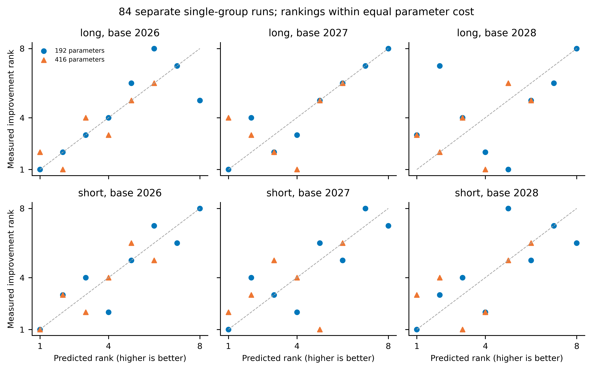
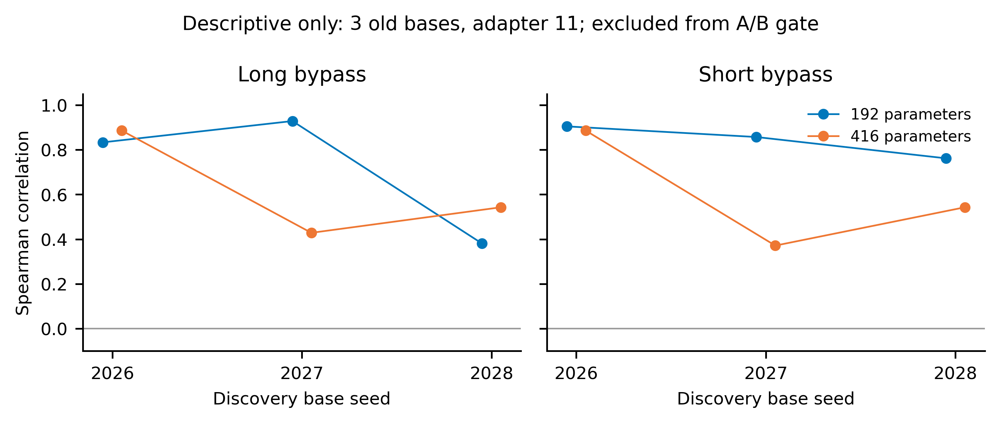

# 第0步单组预测诊断：代理有排序信号，C/R标签优势仍未成立

正式机制阶段完成84条独立600步轨迹、168条180/600步验证记录。每种宽度3个旧发现基础2026–2028、adapter seed=11，分别只训练末层14个C/R组的一个rank1适配器。Q/K/V/up/gate切输入列，O/down切输出行。

这些是实际单组训练，未把全局方法的总改善分摊给各组。Attention单组成本192，MLP单组成本416；主要解释必须按相同实际参数成本分层。代理预测为初始双侧对角谱的rank1前缀收益，实际改善为冻结基础验证loss减600步验证loss，未拟合比例系数。

|宽度|基础|Attention 8组、192参数 Spearman|MLP 6组、416参数 Spearman|混合14组（有成本混杂）|
|---|---|---:|---:|---:|
|long|2026|0.833333|0.885714|0.740659|
|long|2027|0.928571|0.428571|0.841758|
|long|2028|0.380952|0.542857|0.674725|
|short|2026|0.904762|0.885714|0.956044|
|short|2027|0.857143|0.371429|0.736264|
|short|2028|0.761905|0.542857|0.736264|

每个基础的两种成本层内相关均为正，但强弱有变化。它支持“这个双侧代理在本设置中对单组有限步收益有一定排序信号”，不支持“能预测最优rank”或“真实C/R标签优于随机标签”。14个组共享同一基础和数据，不能当成14个独立预训练样本做总体显著性结论；只有3个发现基础，不将它们并入10个新基础的主检验。

主实验[报告](../../reports/decisive_stage0_20261122.md)已按锁定CI规则判为B，机制相关是预设次要分析，不推翻这个决定。即使代理区分Q/K/V/O/MLP收益，它也可能主要捕捉模块差异，而真实历史标签没有额外可利用价值；后一句是与结果相容的解释，尚非因果证实。

84个实际末步检查点全部以完整模型独立重载，验证loss误差0，最大FP32合并误差7.62939e-6；实际参数、冻结基础、配对数据轨迹和1314个当时已存在的证据文件散列均通过。检查点只在本地runs/中，轻量CSV、日志、校准NPZ及审计随证据包保存。

数据：[single_group_results.csv](../../results/decisive_mechanism_20261122_01/single_group_results.csv)、[全部相关](../../results/decisive_mechanism_20261122_01/spearman_by_base.csv)、[重载审计](../../results/decisive_mechanism_20261122_01/checkpoint_audit.json)。纯NumPy独立核验重算84个预测和全部18个相关：`python scripts/verify_decisive_mechanism.py results/decisive_mechanism_20261122_01`。

