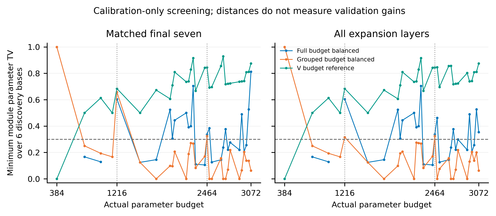
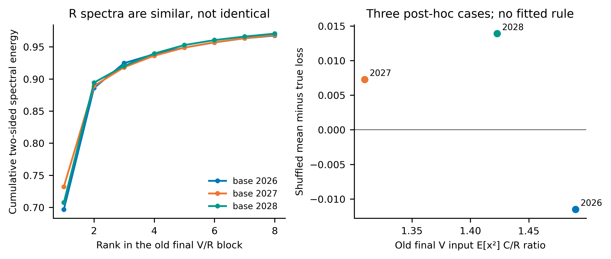

# 第0步离线筛查与2026反向诊断

本报告只记录正式主试验前完成的准备和发现分析，不包含10个新基础的主试验结果。6个旧基础完成72个校准批次，产生2160个分配与20160条谱前缀；无适配器训练步骤。用户已选择整数预算均衡基线、匹配末层七类主范围，正式规格另见锁定协议。

## 原预算确实存在规格冲突

长旁路全扩张层有7矩阵/14组，短旁路有14矩阵/28组。严格整矩阵Uniform的单rank成本分别为2464/4928，严格Grouped-Uniform为4032/8064。原预算384/768/1152/1536/2304/3072不能同时满足严格统一rank和同实际参数。即便忽略rank cap，第一个共同预算也为44352/88704，远离低预算目标。

还存在整数成本可达性问题：全矩阵注意力每rank256，MLP每rank480。384和1152无法精确实现；768/1536/2304/3072虽能实现，却都只能用注意力rank，不能包含MLP。分组MLP成本416，与普通MLP成本不同；忽略这些限制会把成本格点的差异误当分配优劣。

用户明确采用FullBudgetBalanced、GroupedBudgetBalanced等准确命名，避免将稀疏整数均衡冒称严格Uniform。候选矩阵统一为末层Q/K/V/O与up/gate/down；全部扩张层只作为离线补充，避免主对照候选数7/14的混杂。

## 两个非退化候选点

Q/K/V、up/gate按输入列，O/down按残差输出行；双侧相对阻尼先基于完整模块计算再切组。候选只由目标训练校准统计选择，不用新方法验证loss。跨分组/整矩阵不能直接比较rank坐标，因此使用模块参数预算向量TV=L1/(2B)。下表是6个旧基础的最小距离：

| 预算 | 对FullBudgetBalanced | 对GroupedBudgetBalanced | 对V预算参考 |
|---:|---:|---:|---:|
| 1216 | 0.6053 | 0.6579 | 0.6842 |
| 2464 | 0.3377 | 0.3247 | 0.8442 |

这两个点在匹配末层和全部扩张层的整数均衡版本下都通过固定0.30差异门。这是分配有区分力的证据，不是任务收益。V仅为把预算集中到末层V的几何参考；1216/2464下无法实现同rank VBalanced，所以它不参与正式方法排名。预算2464的整矩阵均衡恰为七矩阵全部rank1，提供标准统一rank LoRA锚点。

按残差层宽定义的WidthRankProportional在这里与GroupedBudgetBalanced相同，因为候选层宽全为128。明确标为等价别名，不重复训练或增加证据数。整数均衡仍有并列配置；正式协议预先固定矩阵顺序和DP并列规则，不按验证loss挑基线。

## 2026为什么反向：已知什么，仍不知道什么

这里重新读取已经公布的旧末层Q/V数据，是事后诊断。长旁路三基础如下，正向loss差表示真实分组更好：

| 基础 | V输入E[x²]的C/R比 | V/R双侧谱rank1能量 | C/R首左奇异方向cos² | 随机均值−真实loss | 真实名次/6 |
|---:|---:|---:|---:|---:|---:|
| 2026 | 1.4901 | 0.6967 | 0.9953 | -0.011509 | 6 |
| 2027 | 1.3096 | 0.7322 | 0.9851 | +0.007249 | 1 |
| 2028 | 1.4230 | 0.7076 | 0.9886 | +0.013886 | 1 |

2026的R谱稍慢衰减，C/R输入二阶矩比更高，首输出方向也更接近。它在adapter11/22上都反向，配对差为−0.018257和−0.004762，不是只由一个adapter seed造成。三个基础的真实分配却完全相同（Q0、V的C/R各rank1），所以不能用真实rank分配发生变化解释反向。

旧双侧代理对真实分组相对随机均值的预测差，在长旁路2026/2027/2028为−0.015389/+0.021319/+0.001053，与旧实际差的符号一致。但短旁路三个案例符号全部不一致。因此它最多提供一个待验证线索，不能用这3个长旁路点拟合可靠的切R规则，更不能声称找到了因果机制。

## 已锁定的后续规则

正式主范围为同末层七类，预算1216/2464，10个未用于发现的新基础2029–2038，每个adapter11/22。基础级配对、200000次固定seed百分位bootstrap；两个预算均要求长旁路对普通整矩阵整数均衡和对随机均值的CI下界>0，而且对应长减短交互CI下界>0，才走A。其余走B做文献调研，不并行扩展规模。完整定义见[协议v1](../../plan/decisive-stage0-protocol-v1.md)。

新范围的容量检查已另行完成36条发现轨迹：1216→2464，长/短平均改善0.093738/0.090695；2464→4928继续改善0.044683/0.050994，全部基础配对均值同向。36个检查点完整重载loss误差0。容量数据见`runs/decisive_capacity_20261122_01`；它不混入主试验统计。

在正态配对t规划近似下，SD0.013、效应0.01、双侧alpha0.05时，n10功效约0.583，约16个基础才达到80%。这不是bootstrap或联合8条件门的精确功效，旧SD也只由3个基础估计。10个基础是本轮规模选择，阴性不等于已证明等效。参考[statsmodels定义](https://www.statsmodels.org/stable/generated/statsmodels.stats.power.TTestPower.power.html)。

## 证据与复核

- [轻量证据包](../../results/decisive_preflight_20261122_01/README.md)、[预算可行性](../../results/decisive_preflight_20261122_01/budget_feasibility.csv)、[完整分配](../../results/decisive_preflight_20261122_01/allocations.json)
- [非退化汇总](../../results/decisive_preflight_20261122_01/nondegeneracy_summary.csv)、[2026诊断](../../results/decisive_preflight_20261122_01/previous_reversal_diagnostic/case_summary.csv)
- [正式配置](../../configs/decisive_stage0.json)、[用户选择与协议散列](../../results/decisive_preflight_20261122_01/resolved_specification.json)

无torch复核：`python scripts/verify_decisive_preflight.py results/decisive_preflight_20261122_01`。旧方案、六个源权重和1062个旧结果文件SHA不变；36项正确性/协议测试通过。原始选择前状态和用户选择后的规格分开保存，不能把尚未运行的主试验当作已得到的结果。
