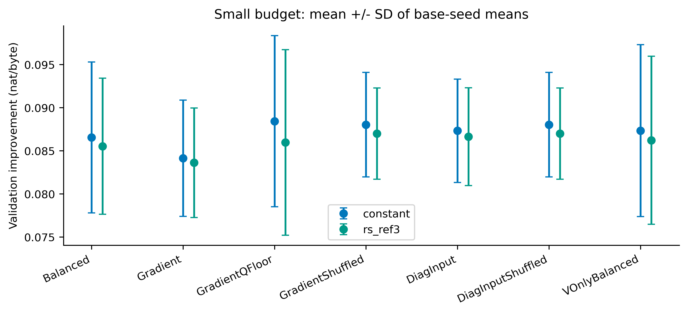
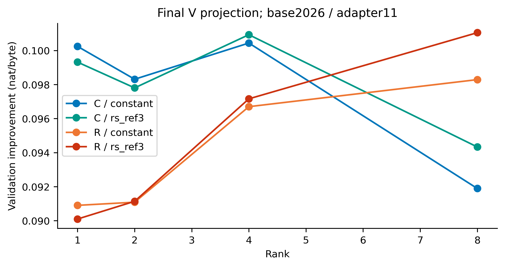
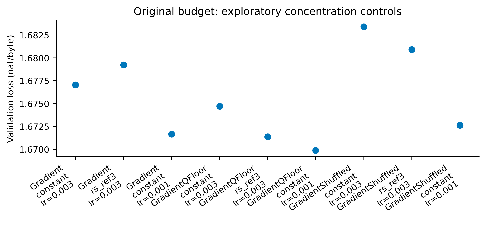

# CarryRank 第二轮诊断：diagnostic_20261122_02

工程审计通过；完成109条轨迹、218条固定步数验证记录。smoke=False。
本轮只作机制诊断，不使用目标测试集选模，不宣称方法优势。三个基础种子各自先聚合适配种子，再比较基础种子间的配对差。

小预算=1024；以下为末步验证loss的基础种子均值（±基础种子均值之间的样本std）。
| 方法 | 缩放 | Val loss | 相对Gradient的配对优势 |
|---|---|---:|---|
| Balanced | constant | 1.67320 ± 0.00535 | 0.00279, 0.00443, 0.00003 |
| Balanced | rs_ref3 | 1.67421 ± 0.00692 | -0.00003, 0.00578, 0.00001 |
| Gradient | constant | 1.67561 ± 0.00561 | 0.00000, 0.00000, 0.00000 |
| Gradient | rs_ref3 | 1.67613 ± 0.00546 | 0.00000, 0.00000, 0.00000 |
| GradientQFloor | constant | 1.67132 ± 0.00230 | 0.00806, 0.00372, 0.00111 |
| GradientQFloor | rs_ref3 | 1.67378 ± 0.00167 | 0.00657, 0.00281, -0.00232 |
| GradientShuffled | constant | 1.67172 ± 0.00645 | 0.00609, -0.00157, 0.00718 |
| GradientShuffled | rs_ref3 | 1.67275 ± 0.00663 | 0.00409, -0.00002, 0.00606 |
| DiagInput | constant | 1.67242 ± 0.00554 | 0.00457, 0.00000, 0.00500 |
| DiagInput | rs_ref3 | 1.67311 ± 0.00610 | 0.00401, 0.00000, 0.00505 |
| DiagInputShuffled | constant | 1.67172 ± 0.00645 | 0.00609, -0.00157, 0.00718 |
| DiagInputShuffled | rs_ref3 | 1.67275 ± 0.00663 | 0.00409, -0.00002, 0.00606 |
| VOnlyBalanced | constant | 1.67241 ± 0.00167 | 0.00849, 0.00015, 0.00098 |
| VOnlyBalanced | rs_ref3 | 1.67353 ± 0.00177 | 0.00674, 0.00153, -0.00046 |

QFloor正数表示：相同代理和参数预算下，保留Q并减少V后验证loss更低。该交换仍同时改变容量分布，不能等同于孤立的Q梯度因果效应。
归一化使用输入二阶矩的对角代理，H_out=I，不是精确Hessian或完整K-FAC。rs_ref3=sqrt(3/r)，rank3时与旧缩放相同。
原预算集中分配只用基础2026/adapter11，属于事后诊断；lr与scale的全部设置见原始表，不可只选最好的一条当主结果。
不把验证指标排名、两条adapter重复或三个基础重复当成论文级确认性证据。

