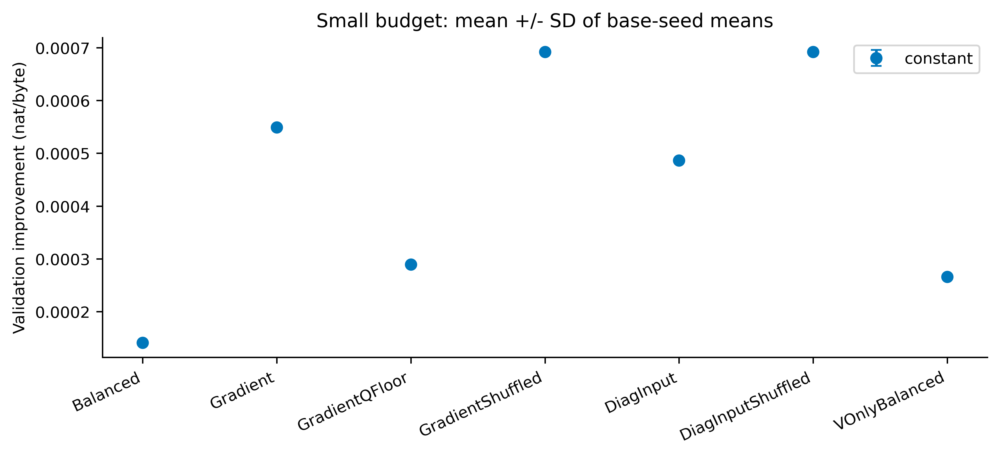
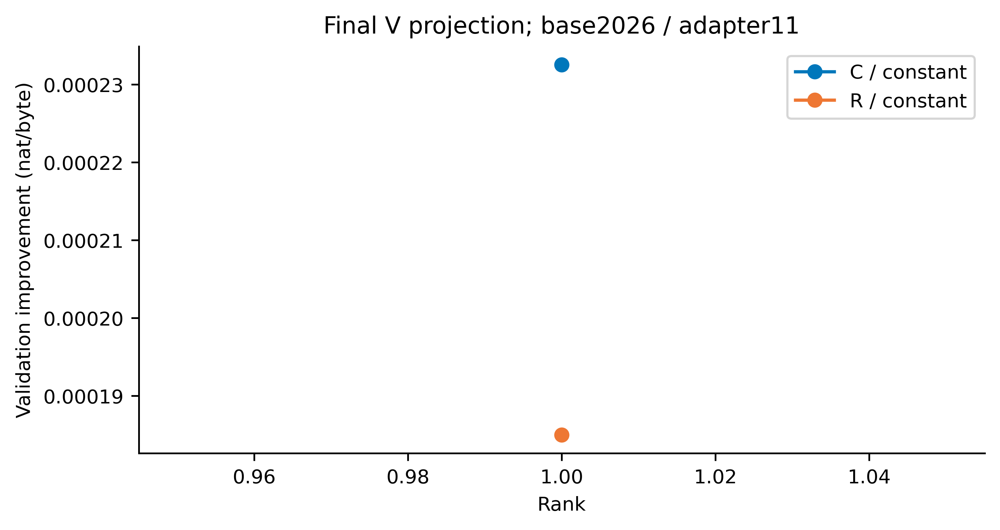
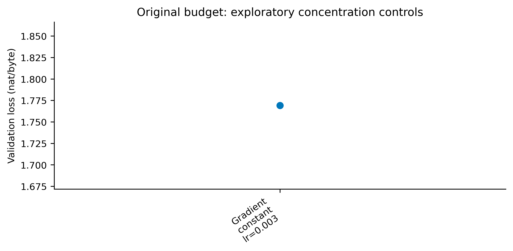

# CarryRank 第二轮诊断：diagnostic_smoke_20261122_01

工程审计通过；完成10条轨迹、10条固定步数验证记录。smoke=True。
本轮只作机制诊断，不使用目标测试集选模，不宣称方法优势。三个基础种子各自先聚合适配种子，再比较基础种子间的配对差。

小预算=1024；以下为末步验证loss的基础种子均值（±基础种子均值之间的样本std）。
| 方法 | 缩放 | Val loss | 相对Gradient的配对优势 |
|---|---|---:|---|
| Balanced | constant | 1.77069 ± 0.00000 | -0.00041 |
| Gradient | constant | 1.77028 ± 0.00000 | 0.00000 |
| GradientQFloor | constant | 1.77054 ± 0.00000 | -0.00026 |
| GradientShuffled | constant | 1.77014 ± 0.00000 | 0.00014 |
| DiagInput | constant | 1.77035 ± 0.00000 | -0.00006 |
| DiagInputShuffled | constant | 1.77014 ± 0.00000 | 0.00014 |
| VOnlyBalanced | constant | 1.77057 ± 0.00000 | -0.00028 |

QFloor正数表示：相同代理和参数预算下，保留Q并减少V后验证loss更低。该交换仍同时改变容量分布，不能等同于孤立的Q梯度因果效应。
归一化使用输入二阶矩的对角代理，H_out=I，不是精确Hessian或完整K-FAC。rs_ref3=sqrt(3/r)，rank3时与旧缩放相同。
原预算集中分配只用基础2026/adapter11，属于事后诊断；lr与scale的全部设置见原始表，不可只选最好的一条当主结果。
不把验证指标排名、两条adapter重复或三个基础重复当成论文级确认性证据。

