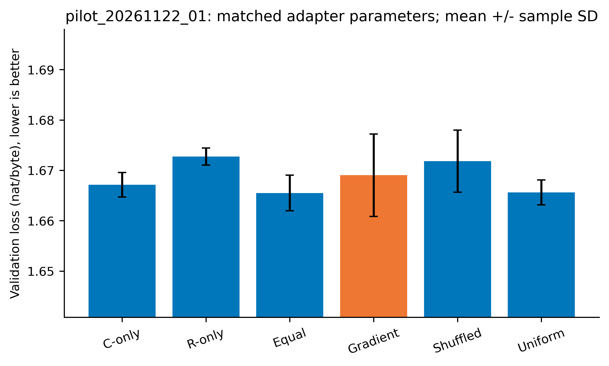
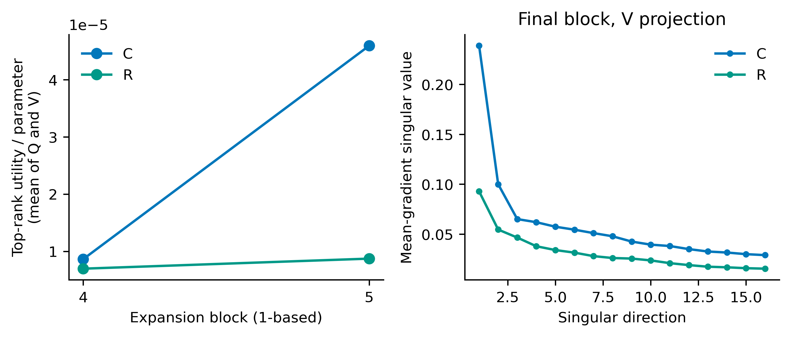
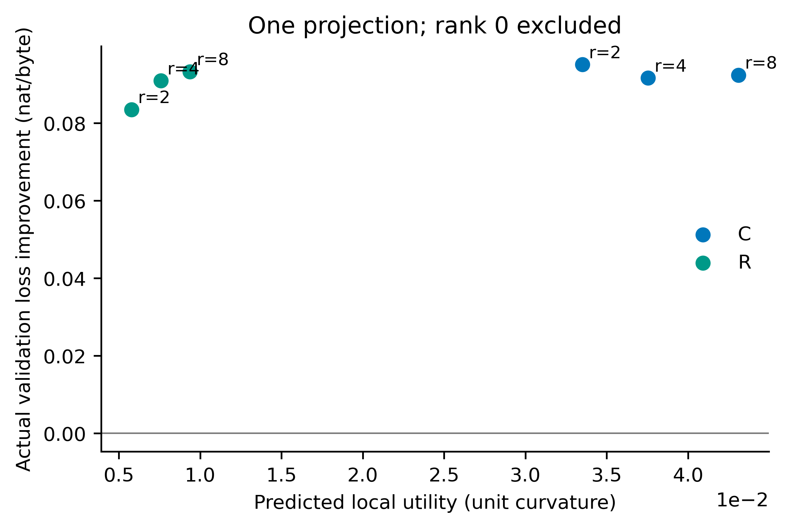

# CarryRank-LoRA 最小实验：pilot_20261122_01

本报告只使用该run的真实测量；是小模型机制初筛，不是MIT模型复现或论文有效性结论。

工程检查：**通过**；预训练质量门：**通过**；预设机制初筛：**未通过**。

基础模型 1,439,296 参数，宽度 `[192, 128, 64, 128, 192]`，从头预训练 1200 步，源验证最优步数 1200。
源验证loss：随机初始化 5.55272 → 1.57062 nat/byte；冻结基础模型目标验证loss为 1.77083。
预训练耗时 84.5s；校准 0.63s，24,576 个训练字节。

主要对照都训练 180 步、3,840 个参数；3个适配种子，共用一个预训练模型。数值为均值±样本标准差。

| 方法 | Val loss ↓ | Test loss ↓ | Val改善 ↑ | 训练秒 | 峰值MB |
|---|---:|---:|---:|---:|---:|
| C-only | 1.66715 ± 0.00244 | 1.73694 ± 0.00460 | 0.10368 | 4.8 | 100.6 |
| R-only | 1.67273 ± 0.00167 | 1.74762 ± 0.00141 | 0.09810 | 3.4 | 100.1 |
| Equal | 1.66550 ± 0.00353 | 1.74116 ± 0.00178 | 0.10533 | 4.1 | 101.6 |
| Gradient | 1.66903 ± 0.00818 | 1.75202 ± 0.00658 | 0.10181 | 3.4 | 100.3 |
| Shuffled | 1.67183 ± 0.00616 | 1.75036 ± 0.00842 | 0.09900 | 3.3 | 100.3 |
| Uniform | 1.66563 ± 0.00247 | 1.73987 ± 0.00309 | 0.10520 | 3.6 | 101.6 |

Gradient相对对照的配对验证loss优势（正数表示Gradient更好）：

| 对照 | 三种子配对差 | 平均差 |
|---|---|---:|
| Equal | -0.01635, 0.00404, 0.00174 | -0.00352 |
| Shuffled | 0.00087, 0.00575, 0.00180 | 0.00281 |
| Uniform | -0.01015, 0.00090, -0.00093 | -0.00339 |
| C-only | -0.01103, 0.00755, -0.00215 | -0.00188 |
| R-only | -0.00339, 0.00971, 0.00479 | 0.00370 |

预测诊断：排除共享rank0，6个点的Spearman=0.5429；原始尺度MAE=0.068325。
最佳非负缩放系数=2.77033，缩放后MAE=0.0410463（同批点拟合，只作描述）。
相关系数混合rank与组别，不能单独证明跨组排序；单位曲率局部预测和180步Adam收益的尺度不一致属预期风险。

继续判断：未达到预设结构优势门。本轮保留全部负/混合结果，暂不扩展K-FAC、动态rank或V2。

限制：仅一种小模型宽度、同语料后段适配、一个预训练种子、固定校准与随机分组种子、少量rank点；没有AdaLoRA/EVA/GEAR比较。测试集只用于最终固定检查点评估，不参与分配或选模。

审计文件：`identity.json`、`data_manifest.json`、`environment.json`、`environment-freeze.txt`、`allocations.json`、`verification.json`、`verdict.json`；原始逐步日志在`logs/`。

