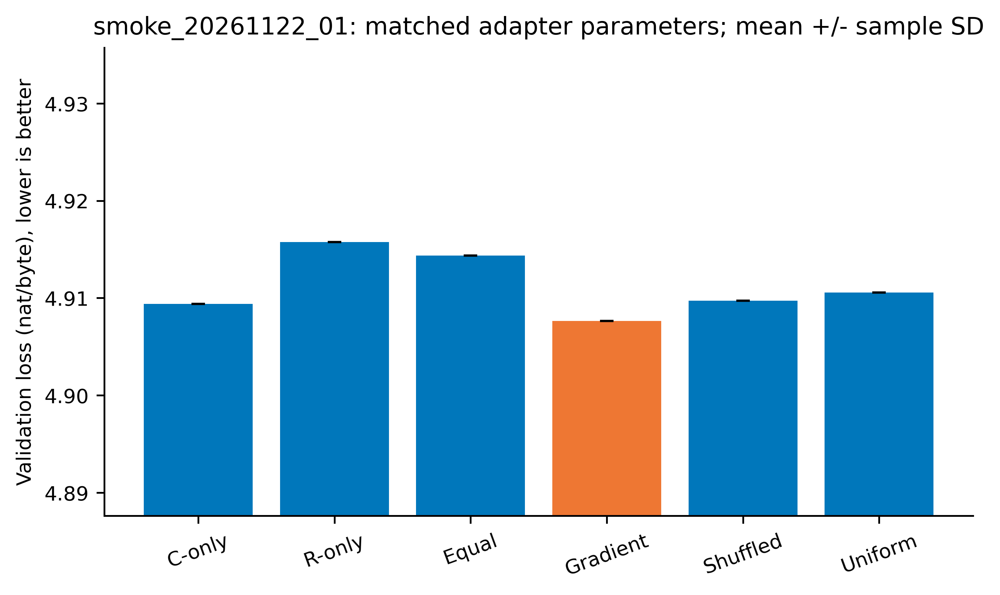
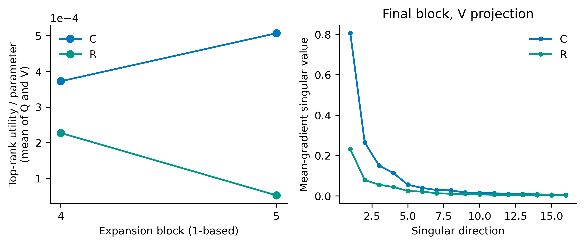
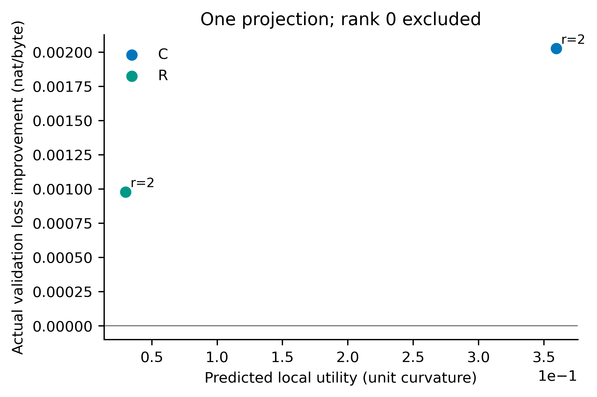

# CarryRank-LoRA 最小实验：smoke_20261122_01

本报告只使用该run的真实测量；是小模型机制初筛，不是MIT模型复现或论文有效性结论。

工程检查：**通过**；预训练质量门：**未通过**；预设机制初筛：**未通过**。

基础模型 1,439,296 参数，宽度 `[192, 128, 64, 128, 192]`，从头预训练 3 步，源验证最优步数 3。
源验证loss：随机初始化 5.58855 → 4.99233 nat/byte；冻结基础模型目标验证loss为 4.91828。
预训练耗时 0.2s；校准 0.11s，128 个训练字节。

主要对照都训练 3 步、3,840 个参数；1个适配种子，共用一个预训练模型。数值为均值±样本标准差。

| 方法 | Val loss ↓ | Test loss ↓ | Val改善 ↑ | 训练秒 | 峰值MB |
|---|---:|---:|---:|---:|---:|
| C-only | 4.90941 ± 0.00000 | 4.91223 ± 0.00000 | 0.00888 | 0.1 | 71.7 |
| R-only | 4.91574 ± 0.00000 | 4.91940 ± 0.00000 | 0.00254 | 0.0 | 71.7 |
| Equal | 4.91437 ± 0.00000 | 4.91708 ± 0.00000 | 0.00391 | 0.1 | 71.7 |
| Gradient | 4.90763 ± 0.00000 | 4.90900 ± 0.00000 | 0.01065 | 0.1 | 71.7 |
| Shuffled | 4.90974 ± 0.00000 | 4.91210 ± 0.00000 | 0.00854 | 0.0 | 71.7 |
| Uniform | 4.91057 ± 0.00000 | 4.91330 ± 0.00000 | 0.00771 | 0.1 | 71.7 |

Gradient相对对照的配对验证loss优势（正数表示Gradient更好）：

| 对照 | 三种子配对差 | 平均差 |
|---|---|---:|
| Equal | 0.00674 | 0.00674 |
| Shuffled | 0.00210 | 0.00210 |
| Uniform | 0.00294 | 0.00294 |
| C-only | 0.00177 | 0.00177 |
| R-only | 0.00810 | 0.00810 |

预测诊断：排除共享rank0，2个点的Spearman=1.0000；原始尺度MAE=0.193232。
最佳非负缩放系数=0.00581929，缩放后MAE=0.00043499（同批点拟合，只作描述）。
相关系数混合rank与组别，不能单独证明跨组排序；单位曲率局部预测和180步Adam收益的尺度不一致属预期风险。

继续判断：未达到预设结构优势门。本轮保留全部负/混合结果，暂不扩展K-FAC、动态rank或V2。

限制：仅一种小模型宽度、同语料后段适配、一个预训练种子、固定校准与随机分组种子、少量rank点；没有AdaLoRA/EVA/GEAR比较。测试集只用于最终固定检查点评估，不参与分配或选模。

审计文件：`identity.json`、`data_manifest.json`、`environment.json`、`environment-freeze.txt`、`allocations.json`、`verification.json`、`verdict.json`；原始逐步日志在`logs/`。

